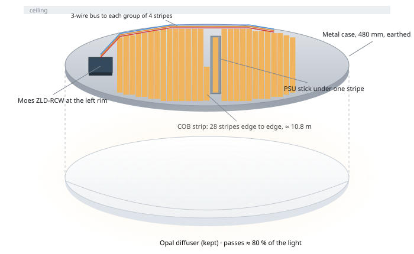
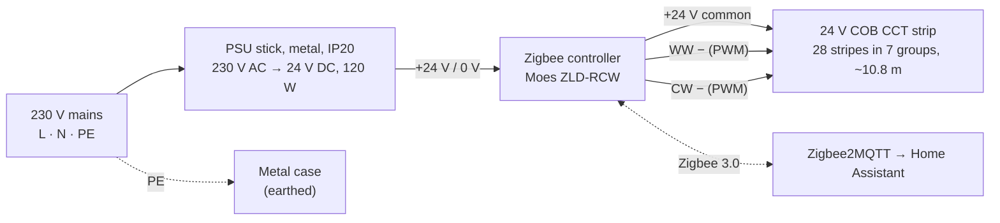
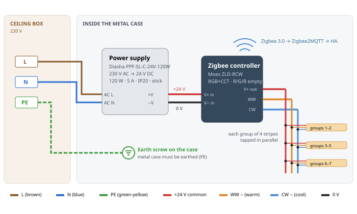
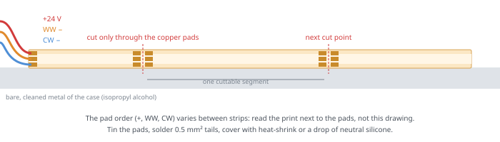
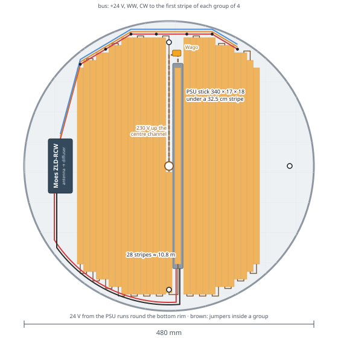
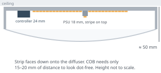

# LedLamp — rebuilding a Chinese ceiling lamp as a Zigbee tunable-white light

Keep the lamp's **metal case** and diffuser; replace everything inside with:

1. **COB LED strip, tunable white (CCT)**: warm 2700 K to cool 6500 K, dot-free under the diffuser.
2. **Zigbee CCT controller**: paired with the house's Zigbee2MQTT, so HA gets brightness + colour temperature.
3. **Slim 24 V power supply**.

**Constraints:** living room (IP20 parts are fine, nothing sealed needed), **Zigbee only**, **≤ 2500 UAH** in total,
and as bright as possible within that.

**The lamp:** Luxel **CLRR-72**, a round remote-controlled fitting, **480 mm across** (measured) and about 50 mm deep.
Its label says **72 W, 175–260 V, 5400 lm**.

**What's inside now** (from a photo of the opened lamp): two square LED boards, about 33 cm and 24 cm across, carrying
roughly **75 separate LEDs under small lenses**, about 2.3 m of board in total. A small mains driver in a clear plastic
box and a 3-way terminal block (L, N, earth) sit in the middle, and the base is painted white metal. There are mounting
holes near the rim at the top, bottom and right. The separate lensed LEDs are why the old light looks spotty.

Prices and stock were checked on **2026-09-26** and re-checked on **2026-10-03**, when every part was ready to ship
on prom.ua; the power supply was re-picked on **2026-10-11** for the dense layout. They change often. Rozetka refused automated lookups (HTTP 403). A printable version with drawings, [`LedLamp.pdf`](LedLamp.pdf), is built from this README
and [`docs/`](docs) by `tools/build_pdf.py`.

---

## 1. Parts to buy: ≈ 4200 UAH for the lamp, ≈ 820 for the wall switch

| # | Part | Pick | Shop | Price, UAH |
|---|---|---|---|---|
| 1 | CCT COB strip, **13 m** (≈ 12 m used, 1 m spare) | **LEDTech 24V COB/FCOB CCT 2700–6500K Multi White**: 14 W/m (7+7), 1400 lm/m, 608 LED/m, Ra>90, **10 mm** wide | [prom.ua (LEDTechnics)](https://prom.ua/ua/p2655960753-svetodiodnaya-lenta-ledtech.html) | ~2930 (225.40/m × 13 m) |
| 2 | Zigbee controller | **Moes ZLD-RCW** RGB+CCT, with R, G and B left empty: Zigbee 3.0 (Tuya), DC 12–24 V, 5 channels, 15 A, 2700–6500 K, **90×40×24 mm** | [prom.ua (SELLBOT)](https://prom.ua/ua/p2985124892-kontroler-svitlodiodnih-strichok.html), in one order with the wall switch | 849 |
| 3 | Power supply | **Diasha PPF-SL-C-24V-120W** "pencil" stick: 24 V / 5 A, 120 W, **340×17×18 mm**, metal case, IP20, passive cooling | [prom.ua (EcoLed)](https://prom.ua/ua/p2638245727-ultratonkij-blok-pitaniya.html), Smart delivery (free to a Nova Poshta branch) | 320 |
| 4 | Wire (0.75 + 0.5 mm²), heat-shrink, 3 **WAGO 221-412** (2-wire, genuine, 23 each) | wire local; WAGO from [prom.ua (Електро Крамниця)](https://prom.ua/ua/p1776340735-klema-shvidkogo-montazhu.html), in one order with the wall switch's blank | — | ~100 |
| | **Total (lamp)** | | | **≈ 4200** |

**About 13 m of strip.** The dense layout (28 stripes, ≈ 10.8 m; up to 30 if your case allows, ≈ 11.9 m) leaves the rest for
cutting mistakes and a spare stripe for repairs. If the first 7 m are already bought, about 6 m more (~1350) is enough.
The listing is priced per metre; if they only sell whole 5 m reels, three reels (15 m) cost ~3380. The extra strip and
the bigger power supply put the lamp well over the original 2500 budget, in exchange for about twice the light; the wall switch ([`docs/wall-switch.md`](docs/wall-switch.md)) adds ≈ 820. The [LT COB-24-MW-608 at svetum](https://svetum.com.ua/ua/catalog/svetodiodnaya-lenta/led-lenta-lt-cob-608sht-m-7-7w-m-24v-ip20-2700-6500k-multi-white-10mm-cob-24-mw-608-91106/)
(same 7+7 W/m, CRI 90, 10 mm) is sold only in 5 m steps.

**Why these:**
- **Strip:** the only one found that meets every point (2700–6500 K, Ra>90, 10 mm, 14 W/m) at the lowest price. Light
  per metre decides the brightness, so stay at 14 W/m: 10 W/m strips give about a third less.
- **Controller:** no CCT-only Zigbee controller cheaper than the E2-ZR (1210) was in stock in Ukraine on 2026-10-03
  (the Tuya C02Z at 600 was sold out), so the pick is an RGB+CCT unit with R, G and B left unused. The Moes comes
  from SELLBOT, a shop with returns and a 99 % rating, and travels in the same parcel as the wall switch, so it adds
  no delivery. Zigbee2MQTT supports it ([ZLD-RCW_1](https://www.zigbee2mqtt.io/devices/ZLD-RCW_1.html): brightness, color_temp 153–500 mired, colour,
  `do_not_disturb`, power-on behaviour), and it is mains-powered, so it is a Zigbee router. Its PWM frequency is
  unpublished (flicker on phone cameras is possible; flicker you can see is not expected) and it has no RF remote.
  Its temperature rating isn't published either, so it sits at the rim, away from the strip, and the one-hour test
  (checklist step 9) checks it.
- **Power supply:** it has to be a **metal stick**, because one stripe is stuck on top of it. The 28 stripes draw
  ≈ 76 W (30 stripes ≈ 83 W, 3.5 A), since the controller caps the strip at 7 W/m. The 120 W Diasha runs at about
  65–70 % load, where a 100 W stick would be past 80 % in a warm case with a stripe heating it, and BIOM's sticks stop
  at 72 W. It comes with prom.ua Smart delivery. The listing names no protections and its spec table says 150 W / 6.25 A
  against 120 W / 5 A in the title, so **ask the seller in the prom chat for short-circuit and overload protection
  before paying**. At 340 mm it fits only within about ±13 cm of the centre, where the case is tall enough. All the
  candidates are in [`docs/parts-candidates.md`](docs/parts-candidates.md).

**Swaps if something is out of stock:**
- Power supply: [PROLUM Series-UTF 100W 24V](https://epicentrk.ua/shop/mplc-blok-zivlenna-prolum-series-utf-100w-24v-4-17a-28542068-1f0868ae-9ece-6d06-8086-1948ee52c82a.html)
  at Epicentr (512, free delivery to Epicentr parcel lockers), 264×21.5×20 mm, sealed aluminium, IP67, short-circuit,
  overload, overheat and overvoltage protection, 24 months: the best-protected stick-shaped unit, at 77–83 % load.
  Or the [LED STORY Profi 100W stick](https://led-story.ua/blok-zhivlennja-24v-41a-100w-ip20-ultratonkij-dovgij-korpus-led-story-profi/)
  (390, led-story.ua only, no Smart), 317×17×17 mm, metal, overload/short-circuit/overheat protection, 2 years.
- Controller: the **MiBoxer FUT037Z+** ([OLX, 679](https://www.olx.ua/d/uk/obyavlenie/svtlododniy-kontroler-mi-light-fut037z-dlya-keruvannya-rgb-rgbw-ta-rgb-cct-led-strchkami-ID10QSv3.html), about 807 delivered, [Z2M](https://www.zigbee2mqtt.io/devices/FUT037Z_.html)),
  another RGB+CCT unit wired the same way (set it to RGB+CCT mode with its button). Same maker as the E2-ZR, 16 kHz
  PWM and an RF remote, 74.5 × 36 × 17 mm, rated −10 to 40 °C; but a private seller, so confirm **FUT037Z+** on the
  label (the plain FUT037 is RF-only) and pay through OLX Delivery.
- Controller, CCT-only: the **MiBoxer E2-ZR** ([OPTSVET, 1210](https://prom.ua/ua/p2560711030-kontroller-light-tunable.html), [Z2M](https://www.zigbee2mqtt.io/devices/E2-ZR.html)),
  the original pick (lamp ≈ 3215). Purpose-built for tunable white, so there is no colour mode to avoid, but at
  100.6 × 40 mm it is a tight fit at the rim.

---

## 2. How it fits together

### Wiring

- **The strip is common-anode**: one `+24 V` pad and two negative pads (`WW`, `CW`). The controller switches the
  negatives. Follow the controller's label for which outputs are V+ and the two whites, and leave R, G and B
  unconnected (the Moes is RGB+CCT only, so there is no mode to set).
- **Use colour temperature only.** HA also shows a colour picker for this light. Picking a colour drives only R, G and B,
  which aren't connected, so the lamp goes dark. Nothing is harmed, but the dashboard should offer colour temperature only.
- **Earth the case.** The PSU sits on mains inside a metal case; connect PE to the case's earth screw. The 24 V side is
  then touch-safe.
- **Wire gauge**: mains 0.75 mm²; PSU → controller and the 3-wire bus 0.75–1.0 mm² (up to 3.5 A in total); tails
  and jumpers between stripes 0.5 mm² / 20–22 AWG (under 0.5 A per group).
- **Solder the strip.** Clip-on connectors are unreliable on COB strip; tin the pads and solder the three wires.

### Layout in the 480 mm case: 28 stripes, edge to edge

- **28 vertical stripes laid edge to edge** (10.5 mm centre to centre) in a band about 300 mm wide through the
  middle, each ending about 15 mm from the wall and cut at the nearest pads (every 25 mm): 42.5 cm in the middle
  down to 32.5 cm at the band's edges, **≈ 10.8 m in total**. If your case has room, one more stripe at each edge
  makes 30 (≈ 11.9 m, ≈ 83 W); the 120 W supply covers that too.
- **The centre column** carries the mains cable in its top half (from the centre hole up to the PSU's input end) and a
  20 cm stripe in its bottom half.
- **The PSU stick sits right of the centre hole**, in place of one stripe, with a **32.5 cm stripe stuck on top** of
  it. It is 340 mm long, so it fits only within about ±13 cm of the centre. Its input end is at the top, where the
  mains cable meets it in a Wago 221; its output end is at the bottom, and the 24 V pair runs round the bottom rim to
  the controller. The stick's metal case is not earthed (2-wire input), so insulate the stripe's solder joints and
  tails from it like everywhere else.
- **The controller sits in the left rim segment**, outside the band. The Moes is **24 mm** thick, so check the free
  height under the diffuser (checklist step 2).
- **Check the mounting holes** on your case before sticking anything. In the drawing the top hole falls in the centre
  channel, the bottom one just below the centre stripe, and the right one in the rim segment.
- **Feed the stripes in groups of 4**: neighbours linked at alternating ends with short jumpers (+, WW, CW), seven
  groups in all, each fed at the top end of its first stripe from the 3-wire bus. A group is about 1.6 m and under
  0.5 A, so the brightness stays even. Do not daisy-chain all the stripes end to end.
- **The old terminal block has to go**; the Wago at the PSU's input end replaces it.
- **Heat:** a Zigbee CCT controller keeps warm + cool at 100 % in total, so each stripe draws at most 7 W/m: ≈ 76 W
  over the base, ~620 W/m² under the band. A test on 2026-10-11 (part of the stripes, edge to edge, one hour at full
  power) left the strip barely warmer than a hand, so it goes straight onto the cleaned, painted steel. The stripe on
  the PSU is the one to watch: the supply's own ~10 W of loss heats it from below, so measure it separately in the
  one-hour test (checklist step 9) and leave it off if it passes ~60 °C.
- **Zigbee through metal is weak.** Mount the controller with the antenna end toward the diffuser. It is mains-powered,
  so it also works as a **Zigbee router**. Its PWM frequency isn't published, so phone cameras may show
  banding; the eye shouldn't.
- COB strip needs little distance to the diffuser: 15–20 mm already looks dot-free.

---

## 3. Build checklist

1. **Before the rebuild**, take lux-meter readings under the old lamp at warm, neutral and cool (see [`docs/brightness.md`](docs/brightness.md)).
2. Measure the free height inside and how the diffuser attaches.
3. Remove the two old LED boards, the driver and the centre terminal block. Clean the painted base where the strip will
   go (isopropyl alcohol).
4. Mark the centre line, the edges of the ~300 mm strip band, the mounting holes, the centre channel, the PSU column
   right of the centre hole and the controller spot in the left rim segment.
5. Cut each stripe at the nearest pads so it ends ~15 mm from the wall, stick them on edge to edge, and insulate every
   solder joint (heat-shrink or Kapton tape) so no pad touches the metal.
6. Mount the PSU stick (thermal tape or screws) and stick its stripe on top; mount the controller at the left rim.
   Link the stripes in groups of 4, run the 3-wire bus to each group, earth the case, run the mains cable up the
   centre channel and join it at the PSU's input end with Wago 221.
7. Bench test first on 24 V: both channels light, correct warm/cool order (swap WW/CW if reversed). At full brightness
   at neutral white the 24 V side should draw about 3.2 A (3.5 A with 30 stripes).
8. Pair with Zigbee2MQTT (permit join, then follow the device's pairing method on its z2m page). Check that
   `brightness` and `color_temp` both work from HA. Set **`do_not_disturb` on**: when power returns after an outage the
   lamp goes back to the state it was in, so a lamp that was off stays off instead of lighting up in the night (with
   it off, the lamp always turns on).
9. Close the diffuser, run at full power for an hour, and check the strip is comfortably warm, not hot (under ~60 °C),
   the controller no more than warm (keep it under about 40 °C), and the PSU warm, not hot. Measure the stripe on the
   PSU on its own.
10. Repeat the lux-meter readings and compare.
11. Fit the wall switch and its automation ([`docs/wall-switch.md`](docs/wall-switch.md)).

---

## Tools

| Script | Does |
| --- | --- |
| `tools/build_pdf.py` | builds `LedLamp.pdf` from this README and `docs/*.md` with headless Chrome (needs `pip install -r tools/requirements.txt`) |

## Docs

| Doc | About |
| --- | --- |
| [`docs/brightness.md`](docs/brightness.md) | how bright the rebuild will be, against the old lamp, and the numbers behind it |
| [`docs/parts-candidates.md`](docs/parts-candidates.md) | every strip, controller and power supply found, with prices and links |
| [`docs/option-b-mains-driver.md`](docs/option-b-mains-driver.md) | the fewer-parts option (a mains Zigbee driver) and why it was not chosen |
| [`docs/wall-switch.md`](docs/wall-switch.md) | the wireless rocker switch fixed into the old wall box, and its automation |
